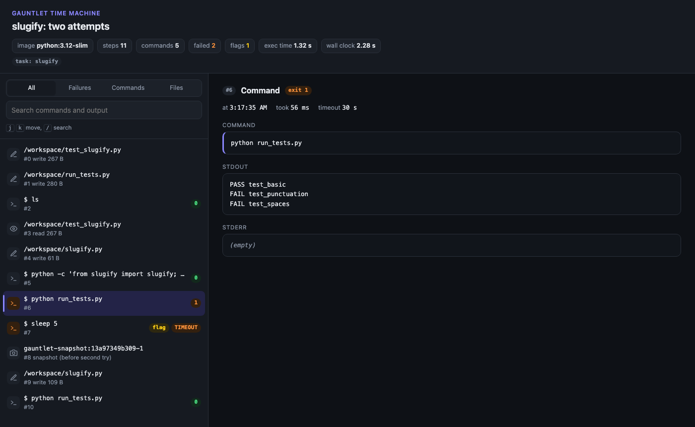

# gauntlet-timemachine

Rewind an AI agent's run to any step, try something different from there, and see exactly where two runs split.

When an agent fails a task at step 40, you don't want to rerun the whole thing to test a hunch about step 31. With this you replay the first 31 steps into a fresh container, take the wheel, and go a different way. Every run it touches comes from [gauntlet-sandbox](https://github.com/abhishekcpp007/gauntlet-sandbox), which records each command, file write and archive as it happens.

```bash
timemachine view run.jsonl --open        # browse it
timemachine replay run.jsonl             # is it reproducible?
timemachine branch run.jsonl --at 31     # rewind and take over
timemachine diff run.jsonl retry.jsonl   # where did they split?
```

## The viewer

`timemachine view` turns a trajectory into one HTML file. No server, no CDN, nothing to install, so you can attach it to a bug report or drop it in Slack and it just opens.



Open [`examples/sample.html`](examples/sample.html) for a live one. It's a real run where an agent writes a slugify function, fails two tests, hangs on a command, then gets it right on the second try.

- Every step on a timeline, with exit codes and TIMEOUT badges
- Full command, stdout and stderr, or file contents, for whichever step you click
- Filter to failures, commands or file steps, and search across all of it
- `j` and `k` to move, `/` to search
- Flags from other tools (like Cheat Catcher) show up as warnings on the steps they point at
- Light and dark, follows your OS

## Replay

```python
from gauntlet_sandbox import Trajectory
from gauntlet_timemachine import replay

report = replay(Trajectory.load("run.jsonl"))
print(report.deterministic)
for d in report.divergences:
    print(d.step, d.field, d.original, "->", d.replayed)
```

Replay boots a new sandbox with the same config, runs each recorded action again and compares what comes back: exit code, stdout, stderr and the timeout flag for commands, contents for file reads. Durations get ignored since they never match.

A divergence isn't always bad news. `date`, random seeds and network calls all diverge on purpose. But if `pytest` passes in the original and fails on replay, you've got a flaky test or a hidden dependency on state you didn't record, and you want to know that before you trust the reward.

`replay(traj, upto=10)` stops after ten steps. `image=` swaps the base image, which is a quick way to ask "does this still work on Python 3.13?".

## Branch

```python
from gauntlet_timemachine import branch

sb = branch(traj, at=31, trajectory_path="retry.jsonl")
try:
    sb.exec("pytest -x tests/test_api.py")  # step 31, done differently
finally:
    sb.close()
```

You get a live sandbox in the exact state the original was in right before step 31. Its trajectory includes the 31 replayed steps plus whatever you do next, and its header records `branched_from` and `branched_at`, so the new file stands on its own.

On the command line, `timemachine branch run.jsonl --at 31 --record retry.jsonl` drops you into a shell at that point.

## Diff

```
$ timemachine diff run.jsonl retry.jsonl
same for the first 31 step(s), then they split
at step 31: action.command differ

A (run.jsonl), 9 more step(s):
  #31 $ pytest tests/test_api.py  -> exit 1
  ...
```

## How it replays each step

| Recorded action | On replay |
|---|---|
| `exec` | Same command, workdir, env and timeout |
| `write_file` | Same bytes, same mode |
| `read_file` | Reads again and compares the content |
| `put_archive` | Unpacks the archive saved beside the log in `run.blobs/` |
| `snapshot` | Takes it again, then deletes the image so replays don't pile up |

Keep the `.blobs` folder next to the `.jsonl`. If it's gone, replay stops with a clear error at the first archive step instead of quietly building the wrong filesystem.

## Install

```bash
pip install gauntlet-timemachine
```

Needs Docker for `replay` and `branch`. `view` and `diff` work anywhere.

## Part of Gauntlet

This is piece three of **Gauntlet**, an open source proving ground for AI coding agents:

- [gauntlet-sandbox](https://github.com/abhishekcpp007/gauntlet-sandbox) runs agent actions in locked-down containers and records them
- [gauntlet-repo2env](https://github.com/abhishekcpp007/gauntlet-repo2env) turns real repos into graded coding tasks
- gauntlet-timemachine (this one) replays and rewinds those runs
- Cheat Catcher flags agents that game the tests, and the Arena puts it all on a live leaderboard

## Develop

```bash
uv sync
uv run pytest     # Docker tests skip themselves if Docker isn't running
uv run python examples/record_demo.py   # regenerates examples/sample.html
```

MIT licensed.
